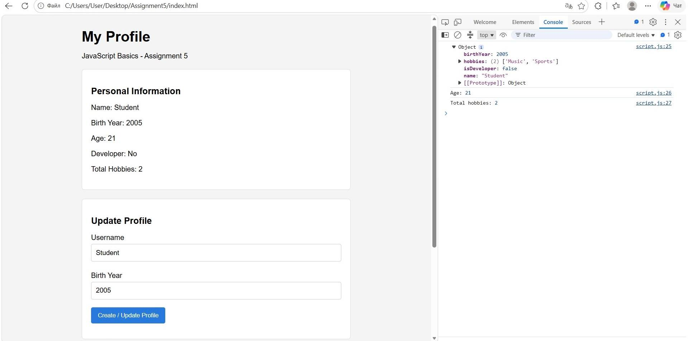
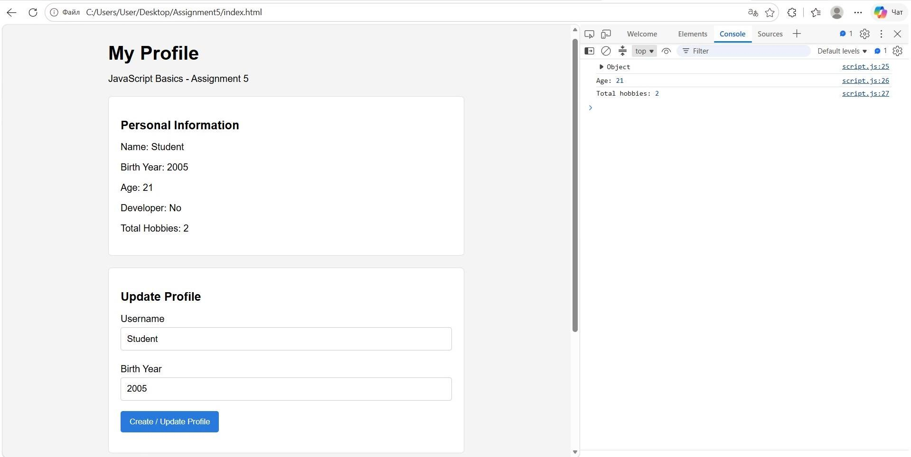
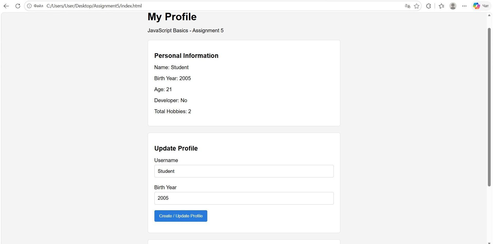
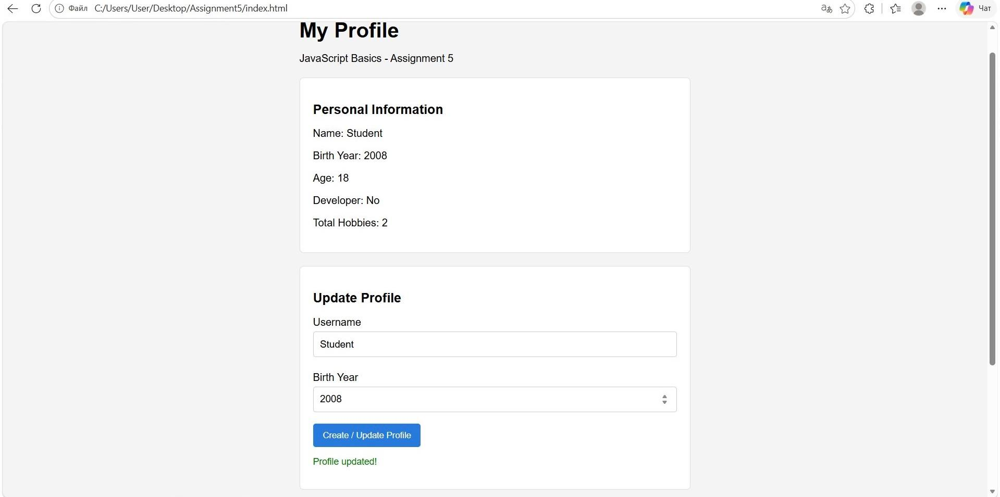
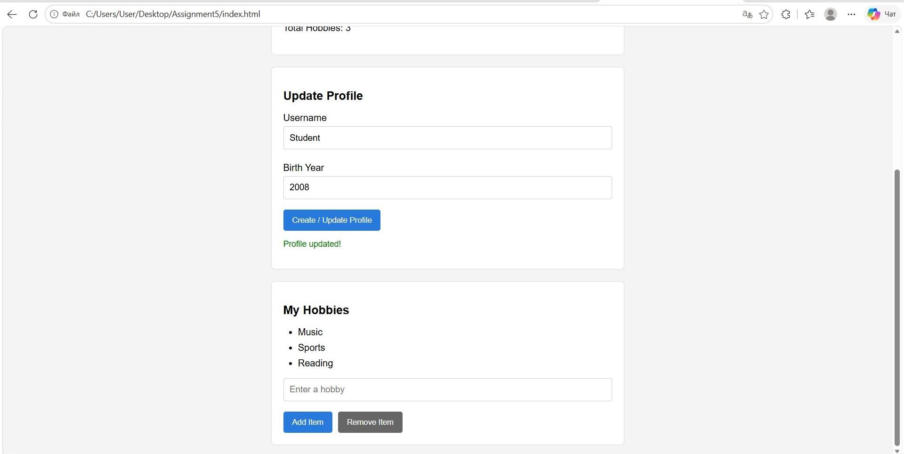

# Assignment 5 - JavaScript Basics

**Name:** Yerassyl Nauryzgali 
**Group:** IT-2513  
**Subject:** Web Technologies 1 

## Objective

The main goal of this assignment is to learn the basics of JavaScript, including objects, data types, arithmetic operations, DOM manipulation, and event handling.

I created a simple personal profile website where users can view their information, update their name and birth year, and manage a list of hobbies.

## Task 1 - Personal Info Object

In this task, I created a JavaScript object named `userProfile`.

The object contains four different data types:

- **String:** stores the user's name.
- **Number:** stores the user's birth year.
- **Boolean:** shows whether the user is a developer.
- **Array:** stores a list of hobbies.

I used `console.log()` to display the object in the browser console and check its properties.

## Task 2 - Arithmetic Calculations

In this task, I used JavaScript arithmetic operations to calculate information about the user.

The age is calculated by subtracting the birth year from the current year. I used `new Date().getFullYear()` to get the current year automatically.

I also used `hobbies.length` to calculate the total number of hobbies.

Both results are displayed on the website and in the browser console.

## Task 3 - HTML Form Setup

I created an HTML form that allows users to enter and update their personal information.

The form contains:

- Username input field.
- Birth Year input field.
- Create / Update Profile button.

I used HTML input types and the `required` attribute to make the form easier to use and prevent empty submissions.

## Task 4 - Event Listener

In this task, I connected the HTML form to JavaScript using `addEventListener()`.

When the user submits the form, JavaScript reads the input values and updates the `userProfile` object.

I used `preventDefault()` to prevent the page from reloading after form submission.

After updating the profile, the website displays the new name, birth year, and calculated age without reloading the page.

## Task 5 - DOM List Manipulation

In this task, I created a list of hobbies using HTML and JavaScript.

The page includes an input field and two buttons:

- **Add Item:** adds a new hobby to the list.
- **Remove Item:** removes the last hobby from the list.

I used `createElement()`, `appendChild()`, and `remove()` to work with HTML elements.

I also used `push()` and `pop()` to update the hobbies array.

The total number of hobbies updates automatically when an item is added or removed.

## Technologies Used

- **HTML5:** page structure and input fields.
- **CSS3:** basic styling and layout.
- **JavaScript:** objects, calculations, events, and DOM manipulation.

## How to Run

1. Download the project from GitHub.
2. Open the project folder in Visual Studio Code.
3. Open `index.html` in a browser or use Live Server.
4. Enter a username and birth year to update the profile.
5. Use Add Item and Remove Item to manage hobbies.
6. Open Developer Tools and select Console to view JavaScript output.

## Summary

During this assignment, I practiced working with JavaScript objects, variables, data types, arithmetic operators, and arrays.

I learned how to access and change HTML elements using the DOM and how to handle user actions with event listeners.

The final result is a simple interactive profile website that updates information and manages hobbies without reloading the page.